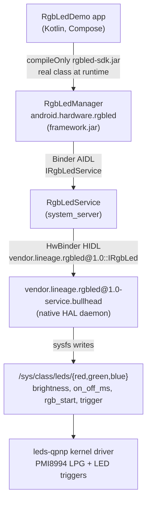

# Nexus 5X RGB LED: from kernel driver to app API

## Motivation

I've been building Android apps since 2014, more than 12 years, almost entirely on top of the SDK. I call
`getSystemService()`, get a manager back, and things happen. I always wanted to know what actually
happens below that call: which process handles it, how it crosses into native code, and how it
finally reaches a device driver.

I tried to trace that path several times on my own and never got far. AOSP is huge, the build is
slow and unforgiving, and every layer has its own language, build system and security rules.

AI tools have changed that. They make it much easier to work through unfamiliar territory, and
that cuts both ways: they also make it easy to *look* competent without really understanding the
code. I wanted to use them for the first purpose, not the second. This project is my attempt to
build one feature through every layer myself, and to understand each layer well enough to explain
it:

1. **Modify a kernel driver** (`leds-qpnp`) so the notification LED supports kernel triggers.
2. **Integrate it with a HAL**: a new HIDL interface and a native service that talks to the driver.
3. **Expose it as a new system service** (`RgbLedService` in `system_server`) with a public
   `RgbLedManager` API and its own permission.
4. **Ship it as an SDK**: a stub jar, so a normal Android Studio app can compile against the new
   API and use the real framework class at runtime.

The docs in this repo are the explanations I wish I'd had when I started.

## About this project

An end-to-end experiment on the **Nexus 5X (bullhead)** running **LineageOS 15.1 (Android 8.1)**:
a new, app-facing `RgbLedManager` system service that controls the notification LED (color,
brightness per channel, hardware blink, kernel LED triggers like `heartbeat`), plus a demo app
that calls it.

The device and Android version are long obsolete, so nobody needs to flash this. The repository
is here to show **every layer you have to touch to add a hardware feature to Android**, and
the tricks needed to make each layer talk to the next one.

<!-- TODO: add a photo or GIF of the LED running the heartbeat trigger -->

## Architecture



| Layer | What was added | Where | Details |
|---|---|---|---|
| Kernel | `heartbeat` trigger enabled; RGB pattern restarted on brightness changes so triggers become visible | `kernel/lge/bullhead` | [docs/01-kernel-driver.md](docs/01-kernel-driver.md) |
| HAL | New HIDL interface `vendor.lineage.rgbled@1.0::IRgbLed` + a bullhead implementation + SELinux policy | `hardware/lineage/interfaces`, `device/lge/bullhead` | [docs/02-hal-and-service.md](docs/02-hal-and-service.md) |
| Framework | `RgbLedManager` (public API), `RgbLedService` (system_server), `CONTROL_RGB_LED` permission | `frameworks/base` | [docs/02-hal-and-service.md](docs/02-hal-and-service.md) |
| SDK | Compile-only stub jar generated from the platform's API stubs | [`sdk/`](sdk/) | [docs/03-sdk-stubs.md](docs/03-sdk-stubs.md) |
| App | Compose demo: colors, per-channel toggles, blink, triggers, live state | [`RgbLedDemo/`](RgbLedDemo/) | [docs/04-demo-app.md](docs/04-demo-app.md) |

## Using the API

```kotlin
val led = context.getSystemService(RgbLedManager::class.java)   // null without the service
led.setColor(0x00FF00, 128)                                      // green, half brightness
led.setBlink(0xFF0000, 255, 500, 500)                            // hardware blink
led.setTrigger(RgbLedManager.CHANNEL_BLUE, RgbLedManager.TRIGGER_HEARTBEAT)
led.turnOff()
```

The app needs `<uses-permission android:name="android.permission.CONTROL_RGB_LED" />`
(a `normal` permission, so it is granted at install). The full API is in [`sdk/api.txt`](sdk/api.txt).

## Repository layout

```
patches/                    git format-patch series, one folder per repo project
  kernel_lge_bullhead/        3 patches: dtc build fix, heartbeat defconfig, qpnp RGB restart
  hardware_lineage_interfaces/  1 patch: the IRgbLed HIDL interface
  device_lge_bullhead/        2 patches: HAL service, SELinux policy
  frameworks_base/            1 patch: RgbLedManager + RgbLedService
manifest-pinned.xml         repo manifest with the exact revisions the patches apply to
sdk/                        build-sdk.sh, api.txt, rgbled-sdk.jar (+ sources jar for javadoc)
RgbLedDemo/                 the demo app (Gradle project)
docs/                       one write-up per layer
```

## Reproducing it

You need a LineageOS 15.1 tree for bullhead. See the
[LineageOS bullhead build guide](https://wiki.lineageos.org/devices/bullhead/build); the 15.1 branch
is archived, so expect some fighting with a modern host.

```bash
# 1. Sync to the same revisions the patches were made on
repo init -u https://github.com/LineageOS/android.git -b lineage-15.1
cp manifest-pinned.xml .repo/manifests/pinned.xml
repo init -m pinned.xml && repo sync -c -j8

# 2. Apply the patches (from the root of the tree)
for p in kernel_lge_bullhead:kernel/lge/bullhead \
         hardware_lineage_interfaces:hardware/lineage/interfaces \
         device_lge_bullhead:device/lge/bullhead \
         frameworks_base:frameworks/base; do
    git -C "${p#*:}" am "$PWD/../nexus5x-rgbled/patches/${p%%:*}"/*.patch
done

# 3. Build and flash
source build/envsetup.sh
breakfast bullhead
m update-api        # regenerates the API stubs that the SDK jar is built from
brunch bullhead

# 4. (Optional) rebuild the SDK jar and copy it into the app
../nexus5x-rgbled/sdk/build-sdk.sh

# 5. Build and install the app
cd ../nexus5x-rgbled/RgbLedDemo && ./gradlew installDebug
```

Check that it works without the app:

```bash
adb shell dumpsys rgbled                 # HAL availability + per-channel state
adb shell cat /sys/class/leds/red/trigger
adb logcat -s RgbLedService RgbLedHal
```

## What is *not* included

Before this feature, I explored the existing lights stack (`liblight`, `android.hardware.light@2.0`,
`BatteryService`, `LineageBatteryLights`) mostly by adding log lines, and tried a dead-end approach
that added heartbeat methods to the AOSP `ILight` HAL. None of that is in these patches. Changing a
frozen AOSP HAL interface is the wrong approach, and it is why the feature uses its own vendor HIDL
package instead (see [docs/02](docs/02-hal-and-service.md#why-a-new-hal-instead-of-extending-ilight)).

## Known limitations

- The system lights (battery, notifications) share the same LED. Whatever you set through
  `RgbLedManager` is replaced the next time one of them updates.
- `CONTROL_RGB_LED` is a `normal` permission. That is fine for a demo, but a real product would use
  `signature|privileged`.
- The API is added to the public SDK (`api/current.txt`) to keep the stub workflow simple. A
  vendor feature would normally live in `lineage-sdk` or be `@SystemApi`.

## License

- Kernel patches: GPL-2.0, like the Linux kernel they modify.
- Everything else (HAL, framework, sepolicy, SDK script, app): Apache-2.0, like AOSP and LineageOS.
